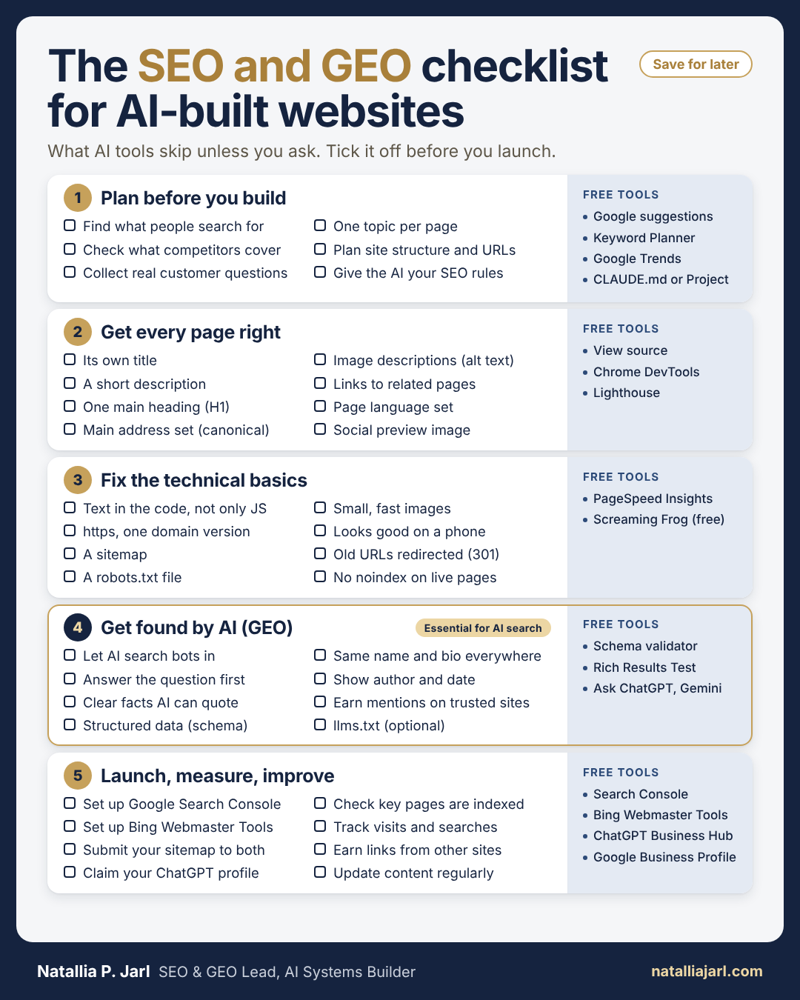

# Vibe coding SEO and GEO playbook

**Make your AI-built website findable on Google and in AI assistants like ChatGPT, Gemini and Perplexity. Works with Claude, Cursor, Codex, Lovable, Bolt and v0.**

AI can build a good-looking website in an afternoon. Whether anyone finds it depends on things AI tools usually skip unless you ask. This playbook does two things:

1. **Brief Claude before it builds** (`seo-geo-brief`): plans keywords and site structure with you, then writes SEO and GEO rules into your project, so every page is built right from the first line of code.
2. **Check before you launch** (`seo-geo-audit`): runs an audit on your site folder or live URL and gives you a score per step and a plain-language fix list, biggest impact first. It changes nothing until you say yes.

Made by [Natallia P. Jarl](https://natalliajarl.com), SEO & GEO Lead and AI Systems Builder. The full playbook, checklist and PDF guide: **[natalliajarl.com/ai-playbooks/vibe-coding-seo](https://natalliajarl.com/ai-playbooks/vibe-coding-seo/)**



## Install

### Claude Code (plugin)

```text
/plugin marketplace add gitnat/vibe-coding-seo-geo-playbook
/plugin install vibe-coding-seo-geo@natalliajarl
```

Then start a session and run `/vibe-coding-seo-geo:seo-geo-brief` before you build, or `/vibe-coding-seo-geo:seo-geo-audit` before you launch. Claude also picks the right skill on its own when you ask things like "check my site's SEO before launch".

### Claude app (web and desktop)

1. Download [`seo-geo-brief.zip`](downloads/seo-geo-brief.zip) and [`seo-geo-audit.zip`](downloads/seo-geo-audit.zip).
2. In Claude, go to **Customize > Skills**, click **+**, then **Create skill > Upload a skill**, and upload each ZIP.
3. Skills need code execution, so check that it is turned on in your settings.

### Cursor, Codex, GitHub Copilot and other coding agents

Each skill is a plain folder with a `SKILL.md` under [`plugins/vibe-coding-seo-geo/skills/`](plugins/vibe-coding-seo-geo/skills/), in the open Agent Skills format. Copy both folders into your agent's skills folder.

### Built with Lovable, Bolt or v0?

These builders do not install skills, but the playbook still works:

1. **Before you build:** copy the [rules file](plugins/vibe-coding-seo-geo/skills/seo-geo-brief/references/rules-file.md), fill in your domain and name, and paste it into your project's knowledge or custom instructions. Every page is then built by the rules.
2. **Before you launch:** run the audit on your live or preview URL:

   ```bash
   python3 plugins/vibe-coding-seo-geo/skills/seo-geo-audit/scripts/audit.py https://your-site.lovable.app
   ```

3. **Watch the first issue.** These tools usually build JavaScript apps, where the text loads in the browser. If the audit says "little or no text in the HTML", ask the builder for static or server-side rendering (prerendering), because most AI crawlers do not run JavaScript.

No Python? Paste the [checklist](plugins/vibe-coding-seo-geo/skills/seo-geo-audit/references/checklist.md) into your builder's chat and ask it to check your site against each item.

## What the audit checks

Five steps, the same as the [checklist](plugins/vibe-coding-seo-geo/skills/seo-geo-audit/references/checklist.md):

| Step | Checked automatically |
|---|---|
| 1. Plan before you build | Clean, lowercase URLs |
| 2. Get every page right | Title, description (present, unique, length), one H1, canonical (and its domain), `lang`, alt text, social preview |
| 3. Fix the technical basics | Text in the HTML (not only JavaScript), robots.txt, sitemap.xml (valid, linked from robots.txt), mobile viewport, image sizes, real 404 page, https, noindex pages listed in the sitemap |
| 4. Get found by AI (GEO) | AI search bots allowed (OAI-SearchBot, ChatGPT-User, Claude-SearchBot, PerplexityBot), structured data (present, valid, `sameAs`, author and date), llms.txt |
| 5. Launch, measure, improve | Manual: Search Console, Bing Webmaster Tools, ChatGPT and Google business profiles, links and mentions |

Claude then reads your key pages for what code cannot judge: does the page answer its question first, are there quotable facts, is your name and bio the same everywhere.

Run the script on its own too (Python 3, no extra packages):

```bash
python3 plugins/vibe-coding-seo-geo/skills/seo-geo-audit/scripts/audit.py ./dist --base https://example.com
python3 plugins/vibe-coding-seo-geo/skills/seo-geo-audit/scripts/audit.py https://example.com
```

Example output for a typical vibe-coded app (text loaded by JavaScript, robots.txt blocking everything):

```text
## Overall score: 31/100

| Step | Score |
|---|---|
| 1. Plan before you build | 100/100 |
| 2. Get every page right | 39/100 |
| 3. Fix the technical basics | 20/100 |
| 4. Get found by AI (GEO) | 12/100 |
| 5. Launch, measure, improve | Manual check |
```

Pages set to `noindex` that are not in the sitemap (demos, previews, thank-you pages) are treated as intentionally hidden and left out of the score.

## Why "brief first"

Asking AI to "add some SEO" at the end gives vague results and means touching every page again. The [rules file](plugins/vibe-coding-seo-geo/skills/seo-geo-brief/references/rules-file.md) tells Claude how to build every page before it writes any code. Feel free to steal it.

## Need a human pair of eyes?

The checklist catches most things. The rest takes human judgement: what to fix first, and what to ignore. For an SEO and GEO review, a launch check or hands-on help for your team, [get in touch](https://natalliajarl.com/ai-playbooks/vibe-coding-seo/#hire).

## License

MIT. Use it, change it, share it. A link back is appreciated.
